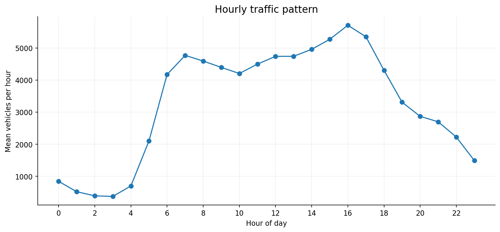
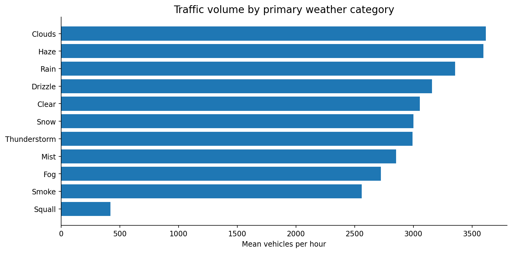
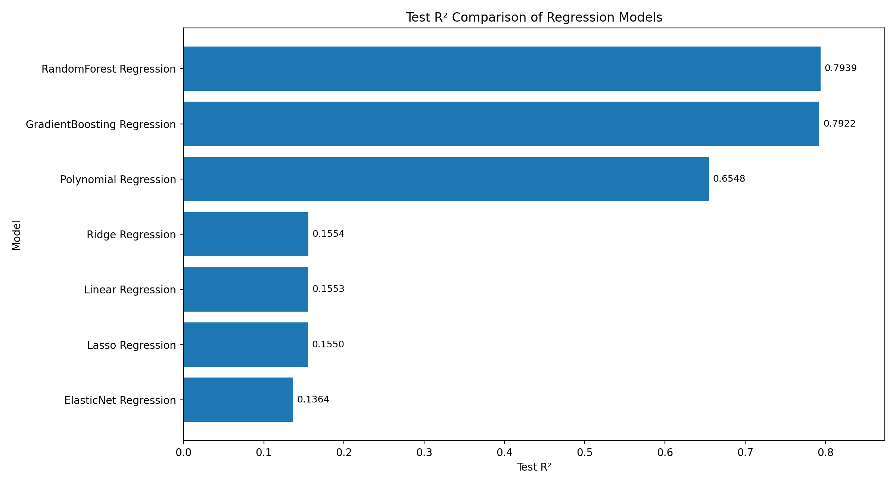
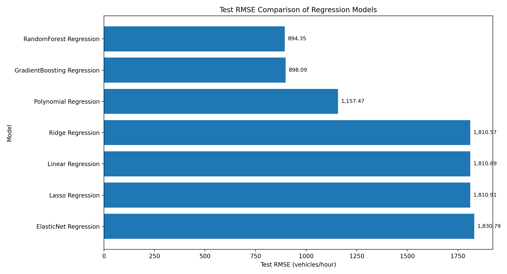
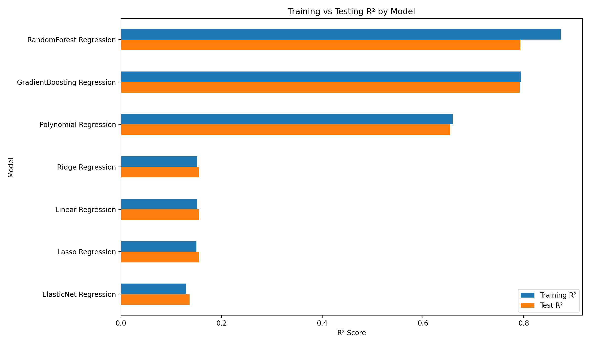
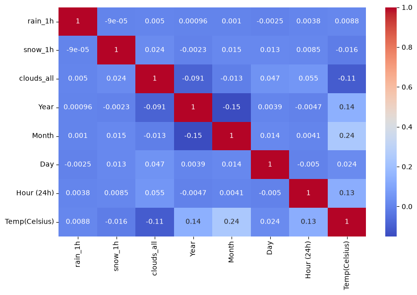
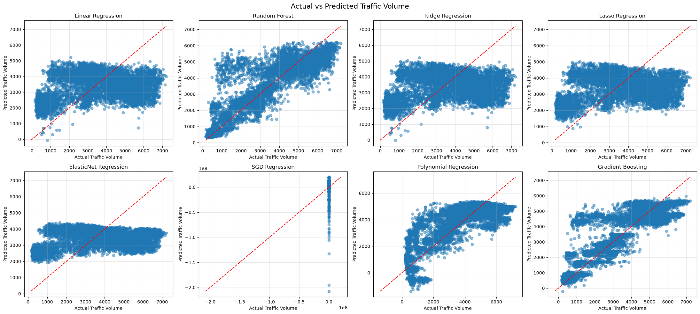
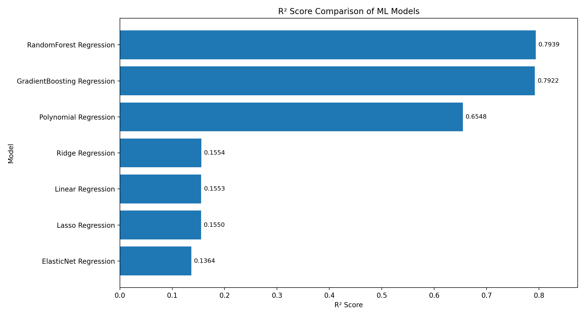

# Metro Interstate Traffic Volume Forecasting

Machine learning regression project predicting hourly Interstate 94 westbound traffic volume using weather and calendar information. Models are evaluated on observations later than their training period.

**Developer:** Mujtaba Ahmed  
**Group:** Individual project (Mujtaba Ahmed)  
**Repository:** [Metro-Interstate-Traffic-Volume-Forecasting](https://github.com/Themujmatrix/Metro-Interstate-Traffic-Volume-Forecasting) (proposed URL; create this repository to activate the link)  
**Dataset:** [UCI Metro Interstate Traffic Volume](https://archive.ics.uci.edu/dataset/492/metro+interstate+traffic+volume)

## Project description

This project investigates the relationship between weather, dates, holidays, and traffic volume and compares eight regression algorithms on a chronological holdout. The target is `traffic_volume`, measured in vehicles per hour.

## Dataset

- Source: UCI Machine Learning Repository, Metro Interstate Traffic Volume (ID 492), attributed to John Hogue (2019).
- Dataset URL: https://archive.ics.uci.edu/dataset/492/metro+interstate+traffic+volume
- Original shape: **48,204 rows × 9 columns**; period **2012-10-02 to 2018-09-30**.
- Columns: `holiday`, `temp` (Kelvin), `rain_1h`, `snow_1h`, `clouds_all`, `weather_main`, `weather_description`, `date_time`, and `traffic_volume`.
- After removing 17 identical rows and keeping the first record for each timestamp, **40,575 hourly observations** remain.

## Method

1. Read the CSV, inspect missing values and duplicates, and fill unlabeled holidays with `None`.
2. Remove full-row duplicates and keep the first weather record for repeated timestamps. This reduces duplicate hours but discards alternate weather observations, which is a limitation.
3. Extract year, month, day, and hour from `date_time`, convert Kelvin to Celsius, and standardize `weather_description` text.
4. Use a `ColumnTransformer` with `StandardScaler` for numeric features and `OneHotEncoder(handle_unknown="ignore")` for categoricals. Polynomial regression also uses degree-2 numerical terms.
5. Sort the existing feature and target rows using the corresponding original timestamps. Use the first 80% for training and the latest 20% for testing (`shuffle=False`).
6. Compare Linear, Ridge, Lasso, ElasticNet, SGD, Polynomial, Random Forest, and Gradient Boosting regression using train/test R², MSE, and RMSE.

### Why chronological splitting?

Because the model is intended to estimate future traffic, evaluation observations must occur **after** the training observations. Sorting by the original `date_time` before the unshuffled split yields a more realistic test than randomly mixing past and future.

**Forecasting limitation:** The features include observed weather for the target hour. A model making forecasts in advance would need weather forecast inputs available at prediction time, not actual future measurements.

## Results (saved Version 6 notebook outputs)

| Model | Training R² | Test R² | Test RMSE (vehicles/hour) |
|---|---:|---:|---:|
| RandomForest Regression | 0.8736 | 0.7939 | 894.35 |
| GradientBoosting Regression | 0.7949 | 0.7922 | 898.09 |
| Polynomial Regression | 0.6595 | 0.6548 | 1,157.47 |
| Ridge Regression | 0.1515 | 0.1554 | 1,810.57 |
| Linear Regression | 0.1515 | 0.1553 | 1,810.69 |
| Lasso Regression | 0.1501 | 0.1550 | 1,810.91 |
| ElasticNet Regression | 0.1299 | 0.1364 | 1,830.79 |
| SGD Regression | -345128941396.6241 | -12504675.0143 | 6,966,532.02 |

**Best recorded model:** RandomForest Regression — test R² **0.7939**, test RMSE **894.35 vehicles/hour**. Gradient Boosting is close behind. Random Forest's training score is higher than its testing score, which warrants further generalization checks.

**SGD:** Test R² **-12,504,675.0143** is severely negative, reflecting unstable optimization. SGD is kept in the results table but excluded from the main comparison charts for legibility. These charts are regenerated from the saved Version 6 model results and reflect Random Forest as the top recorded model.

## Visual analysis

These descriptive graphics were generated from the supplied CSV after the **same first-row-per-timestamp reduction used in the notebook**. They are observational summaries, not new model validation results.

### Hourly traffic

### Weekday patterns

### Weather patterns

### Traffic distribution

### Test R² comparison

### Test RMSE comparison

### Training and testing R²

### Original notebook graphs

#### Correlation heatmap

#### Actual vs. predicted traffic volume

*Note: SGD has highly unstable predictions, which can distort the scale of its subplot.*

#### R² comparison chart

## Known limitations

- **Temperature handling:** Ten recorded zero-Kelvin values were converted to -273.15 °C and replaced with **-7.2 °C** in this notebook. The replacement is not supported by the dataset evidence and should be revised using a defensible training-only imputation strategy; reported scores therefore remain provisional.
- **Extreme rainfall:** A very high `rain_1h` observation (9831.3) warrants verification. Numerical scaling can be sensitive to such values.
- **Duplicate timestamps:** The notebook keeps only the first weather reading from each repeated hour, potentially losing information.
- **SGD instability:** The default SGD regressor diverged on this setup, so its output should not be interpreted as a useful forecasting score.
- **Redundant categories:** `weather_main` and `weather_description` overlap; an ablation study could evaluate whether retaining both adds predictive value.
- **Modeling improvements:** Add day-of-week, weekend, and cyclic-hour features; compare against a naive time-based baseline; use rolling time-series cross-validation and MAE.

See [ANALYSIS_NOTES.md](ANALYSIS_NOTES.md) for an evidence-based audit.

## Run locally

1. Download `Metro_Interstate_Traffic_Volume.csv` from [UCI](https://archive.ics.uci.edu/dataset/492/metro+interstate+traffic+volume) and place it beside `Metro_Traffic_Forecast.ipynb`.
2. Install requirements using `pip install -r requirements.txt`.
3. Open the notebook in Jupyter and run cells in order. The notebook is included **unchanged** from Version 6, and the saved outputs are retained.

## Files

- `Metro_Traffic_Forecast.ipynb`: version 6 notebook, original code and outputs.
- `Project_Proposal.docx`: project proposal for academic submission.
- `ANALYSIS_NOTES.md`: numerical findings, quality audit, and interpretation.
- `images/`: notebook-exported and generated charts.
- `requirements.txt`: Python dependencies.

## Citation

Hogue, J. (2019). *Metro Interstate Traffic Volume* [Dataset]. UCI Machine Learning Repository. https://doi.org/10.24432/C5X60B
