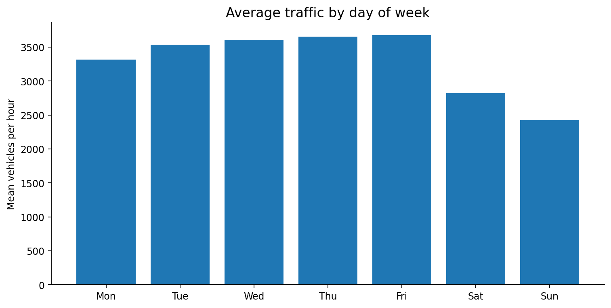
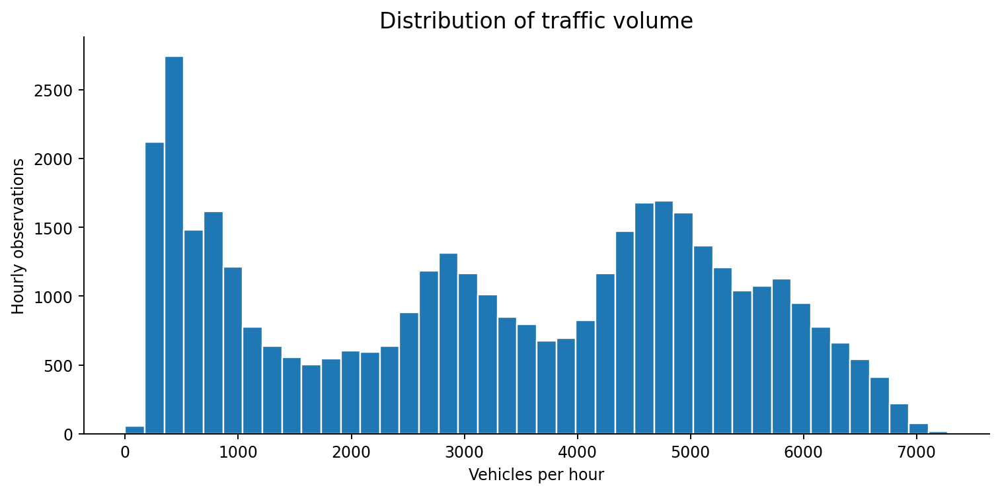

# Metro Interstate Traffic Volume Forecasting

**Machine Learning Regression | Time-Series-Aware Evaluation | Weather & Calendar Features**

Predict hourly westbound traffic volume on Interstate 94 between Minneapolis and St. Paul, Minnesota, using historical traffic observations, weather measurements, holiday indicators, and calendar features.

**Author / Individual project:** Mujtaba Ahmed  
**GitHub repository:** https://github.com/Themujmatrix/reponame  
**Dataset:** [UCI Machine Learning Repository — Metro Interstate Traffic Volume](https://archive.ics.uci.edu/dataset/492/metro+interstate+traffic+volume)

> **Repository URL note:** `reponame` is the repository path provided for this project. Replace it with the actual GitHub repository name if different.

## Project overview

This project investigates whether regression models can learn recurring traffic patterns from historical hourly data. The notebook performs basic cleaning, creates calendar features from timestamps, compares several supervised regression algorithms, and reports predictive performance on chronologically later observations.

## Dataset

| Property | Details |
|---|---|
| Source | UCI Machine Learning Repository, dataset #492 |
| Original observations | 48,204 |
| Dataset period | 2012–2018 |
| Task | Regression |
| Target | `traffic_volume` — reported westbound vehicle count per hour |
| Original columns | 9: eight predictors and the target |
| Location | I-94 westbound, Minnesota DOT ATR station 301 (Minneapolis–St. Paul) |
| Notebook cleaning | 17 full-row duplicates removed, followed by first-row selection per timestamp |
| Rows after timestamp consolidation | 40,575 |

Original fields: `holiday`, `temp`, `rain_1h`, `snow_1h`, `clouds_all`, `weather_main`, `weather_description`, `date_time`, `traffic_volume`.

UCI credits **John Hogue (2019)**, DOI: [10.24432/C5X60B](https://doi.org/10.24432/C5X60B). The dataset is distributed under **CC BY 4.0**.

## Workflow implemented in the notebook

1. Inspect data types, missing entries, duplicated records, and target/features.
2. Fill missing holiday labels with `None` and remove 17 full-row duplicates.
3. Keep one record per hourly timestamp (first occurrence) and align target values.
4. Extract `Year`, `Month`, `Day`, and `Hour (24h)` from `date_time`, then remove the raw timestamp from predictors.
5. Convert recorded Kelvin temperatures to Celsius; normalize `weather_description` capitalization.
6. Encode categorical predictors with `OneHotEncoder(handle_unknown="ignore")`, scale numerical features, and optionally add polynomial terms.
7. Retrieve the timestamps from the original cleaned dataframe by surviving row index, sort the prepared predictors and target chronologically, and use the first 80% for training and last 20% for testing.
8. Fit and compare multiple regression models on the time-ordered holdout set.

### Why the chronological split matters

Because the objective is **future traffic forecasting**, test observations must occur **after** training observations. The project therefore sorts retained records by their original `date_time` values and splits without shuffling. This is a more realistic evaluation of future forecasting than randomly mixing past and future observations.

> Weather observations are used as model inputs. For genuine *advance* forecasts, their values would need to be replaced by weather forecasts available at prediction time. Results using observed same-hour weather should not be presented as a fully operational advance-forecasting system.

## Recorded model results

These scores are transcribed from saved notebook outputs (not independently retrained):

| Model | Test R² | Test RMSE (vehicles/hour) |
|---|---:|---:|
| Gradient Boosting | **0.7919** | **898.73** |
| Polynomial Regression | 0.6528 | 1,160.79 |
| Ridge Regression | 0.1569 | 1,808.95 |
| Linear Regression | 0.1568 | 1,809.07 |
| Lasso Regression | 0.1564 | 1,809.42 |
| ElasticNet Regression | 0.1363 | 1,830.89 |
| SGD Regression | -12,670,103.9711 | 7,012,462.02 |
| Random Forest | Not recorded | Not recorded |

**Best recorded model:** Gradient Boosting Regressor (`learning_rate=0.05`, `n_estimators=200`, `random_state=42`). Its notebook-reported test R² is **0.7919**. The extreme negative SGD result requires debugging and does not represent an acceptable predictive model.

## Visualizations

### Hourly traffic profile


### Day-of-week traffic profile


### Traffic by weather category


### Target distribution


### Model score comparison


### Correlation heatmap (exported directly from the notebook)


Additional observations and caveats: [ANALYSIS_NOTES.md](ANALYSIS_NOTES.md).

## Repository contents

```text
Metro_Traffic_Forecasting_GitHub/
├── README.md
├── Metro_Traffic_Forecast.ipynb
├── Project_Proposal.docx
├── ANALYSIS_NOTES.md
├── requirements.txt
└── images/
    ├── notebook_cell_30_correlation_heatmap.png
    ├── traffic_by_hour.png
    ├── traffic_by_weekday.png
    ├── traffic_by_weather.png
    ├── traffic_distribution.png
    ├── model_r2_comparison.png
    └── model_rmse_comparison.png
```

## How to run

```bash
pip install -r requirements.txt
```

Download the dataset from [UCI](https://archive.ics.uci.edu/dataset/492/metro+interstate+traffic+volume), extract `Metro_Interstate_Traffic_Volume.csv` into the same directory as the notebook, then open and execute `Metro_Traffic_Forecast.ipynb` in Jupyter Notebook or JupyterLab.

The CSV is **not bundled** in this repository package; fetch it from the cited source. The notebook contains stored execution outputs, and not every plotting/model cell was executed in the uploaded version.

## Known limitations & next improvements

- **Temperature quality:** Ten Kelvin-zero measurements convert to `-273.15 °C`; the notebook's current `.replace()` lines return a new Series without updating `X`. Correct them, then refit and reevaluate the models.
- **Hourly duplicates:** Choosing the first timestamp record discards alternative weather descriptions for the same hour. Consider defensible hourly aggregation.
- **Rainfall outliers:** Verify implausible values such as the `9831.3` mm rain observation before modeling.
- **Feature engineering:** Try day-of-week, weekend/holiday flags, and cyclical hour encoding.
- **SGD instability:** Investigate learning rate, unusual feature values, polynomial interactions, and training diagnostics.
- **Evaluation:** Compare against a seasonal hourly baseline, use rolling time-series validation, and report MAE along with R²/RMSE.
- **Visualizations:** Correct the final actual-vs-predicted notebook chart's labels from “Car Prices” to “Traffic Volume”; execute it after all models are fitted.
- **Operational forecasting:** Use only features actually known at the forecast issuance time (especially weather forecasts rather than realized future weather).

## Attribution

Hogue, J. (2019). *Metro Interstate Traffic Volume* [Dataset]. UCI Machine Learning Repository. https://doi.org/10.24432/C5X60B
